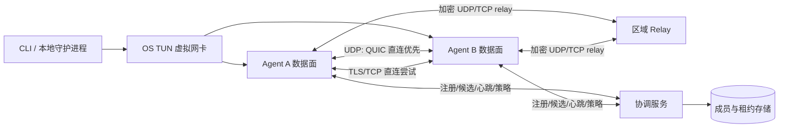
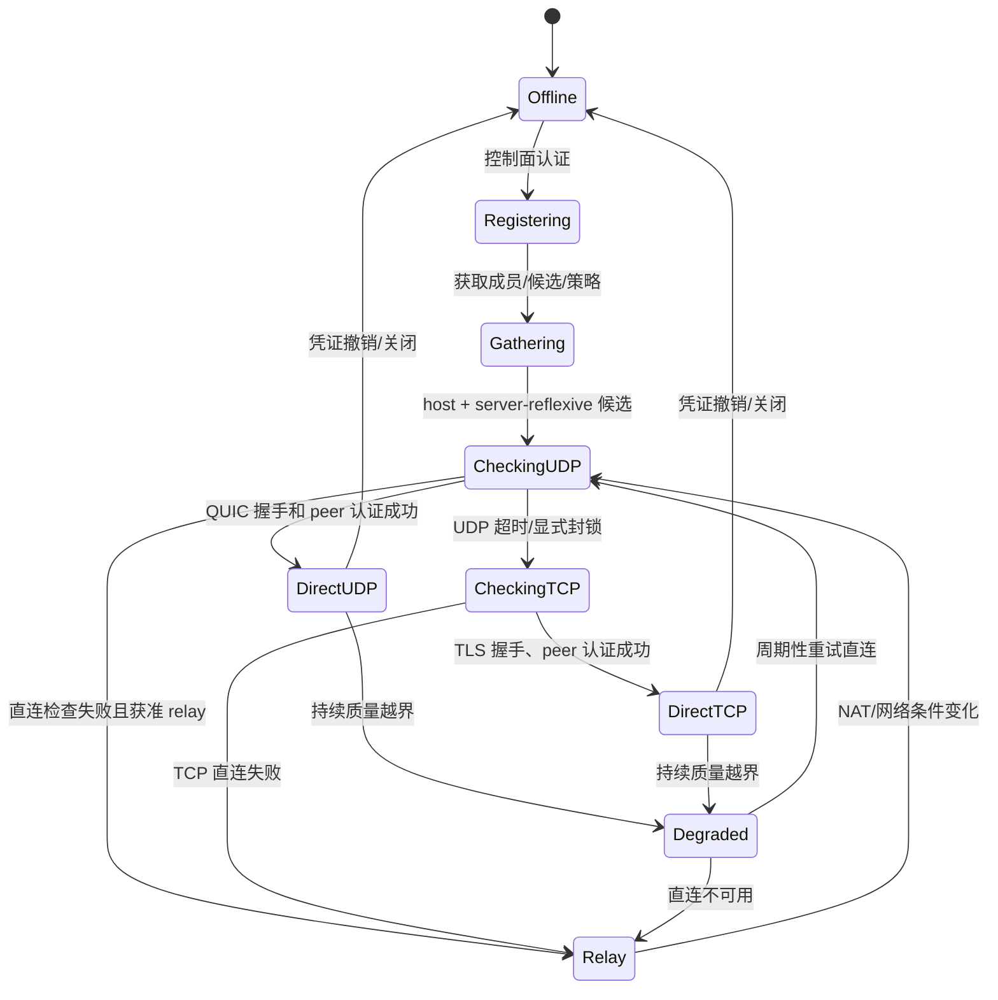

# Mini Tunnel：极简 P2P Overlay 架构设计

版本：0.1（设计基线）　日期：2026-10-29

## 1. 目标与核心决策

构建一个用户空间三层 overlay 网络：用户创建一个虚拟网络，设备通过网络 ID 和短期加入凭证认证；协调服务帮助发现在线成员并交换连接信息；数据面优先建立加密的 UDP 直连，失败时使用 TCP 直连或中心 relay。中心服务不作为必经数据路径。每个成员可获得稳定的虚拟私网 IP。

**已选实现语言：Rust。** 客户端、协调服务和 relay 共用协议类型与序列化代码；通过 TUN 设备承载 IP 包，初期仅承诺 IPv4 unicast。控制面 HTTPS/WebSocket；数据 UDP 使用 QUIC v1（含加密、拥塞控制、路径迁移能力）承载自定义 overlay packet；TCP fallback 使用 TLS 1.3 长连接和有长度前缀的 packet framing。Rust 的异步生态和跨平台编译适合单一 agent；平台 TUN 权限、网络配置、服务安装必须分别实现。首版保持单一语言。

**重要边界：** QUIC 是 UDP 上的传输，不存在“QUIC 降级到 TCP”的透明模式。UDP 和 TCP 是两种独立的传输承载，复用同一 overlay packet 格式与会话密钥派生规则。TCP 只在 UDP 不可达或持续质量明显不合格时启用；对拥塞/丢包盲目切 TCP 可能更差。

## 2. 组件和拓扑



| 组件 | 职责 | 不负责 |
|---|---|---|
| `tunneld` agent | TUN、加密、路由、peer 会话、探测、故障切换 | 账号/组织管理后台 |
| Coordinator | 设备注册认证、网络成员和地址租约、在线状态、STUN/ICE 信令、策略、relay 凭证签发 | 默认转发 peer 用户数据 |
| STUN/Connectivity service | 发现映射地址、辅助 UDP 可达性检查 | 单独保证所有 NAT 可打洞 |
| Relay | UDP/TCP 兜底转发已加密 packet，按额度限流 | 解密 overlay 内容或分配网络身份 |
| CLI | `create/join/up/status/peers/leave` 等易用入口 | 强制要求用户理解路由/隧道协议 |

已有会话可在控制服务短暂不可达时按最近一次已签发、未过期配置继续转发；新建组网、成员变更和新地址分配则暂不可用。relay 需要独立可达，所以严格意义上的“中心服务器完全故障仍可通信”只适用于已建立的 P2P 数据路径。

## 3. 用户体验与身份模型

示例 CLI：

```sh
# 管理员创建网络，产生可撤销的一次性邀请凭证
mini-tunnel network create office --cidr 10.77.0.0/16
mini-tunnel invite office --expires 1h --uses 1

# 新设备用邀请令牌加入；设备私钥在本机生成
mini-tunnel join mt://<network-id>/<invite-token>
mini-tunnel up office
mini-tunnel status
```

- `network_id` 是随机 128-bit 不透明标识（可展示为简短 base32）；它类似 VLAN/租户 ID，只做命名空间选择，不是密码。
- 邀请 token 是高熵、短时、限次数的 bearer credential。服务端只存带盐慢哈希；兑换后立即失效或用次数扣减。可撤销设备证书，不把同一 token 长期发给所有成员。
- Agent 首次启动生成设备密钥对；协调服务认证设备后签发短租期、绑定 `network_id + device_id + virtual_ip + expiry + policy_version` 的成员凭证。设备密钥私有部分永不上传。
- Peer 通道使用设备公钥相互认证并进行密钥协商；推荐用成熟 WireGuard/Noise 实现，不自创密码学。每个网络/peer 会话有独立密钥，定期重协商，支持吊销和设备轮换。overlay IP payload 在 peer 间端到端加密，独立于底层传输；QUIC/TLS 再提供传输连接保护。这样 relay 即使终止客户端到 relay 的 TLS/TCP，也只能看到流量元数据和密文。
- CLI 本地管理 socket 仅允许当前用户访问；凭证放 OS keychain 或权限为 0600 的配置文件。日志严禁输出 token、私钥和完整密钥材料。

## 4. 网络地址与包转发

- 每个虚拟网络持有管理员指定或自动生成的 CIDR（默认 IPv4 RFC1918 地址池；创建时检测本地路由冲突）。Coordinator 用事务性租约分配稳定地址，依据网络 ID 和设备身份保持地址；离网不立刻释放，过期后回收。
- 控制面分配唯一 IP，agent 创建 TUN 并添加该 IP。每个 peer 的虚拟 IP 映射到已认证 peer session；未知源地址、未授权 peer 或不匹配网络 ID 的包丢弃。
- 路由默认只安装网络 CIDR 的精确路由；不接管默认路由、不启用 NAT、不桥接物理以太网。首版不支持任意子网路由、L2 广播、多播和 DHCP；后续作为明确功能扩展。
- MTU 初始建议 1280，实际需考虑底层路径、加密和 UDP/TCP 开销；通过路径探测调低，禁止依赖 IP 分片。超大包通过 TUN MTU 限制或受控分片策略处理。实现阶段对 IPv4/IPv6、ICMP、PMTUD 实测校准。
- Packet envelope 至少含 `version, network_tag, source_device, destination_device, packet_id, payload_len, flags`。接收端先做长度/版本/网络/来源检查，再解密、重放窗口检查、源 IP 校验，最后写 TUN。

## 5. 建连和传输选择状态机



1. Coordinator 为双方交换签名的候选描述和一次性会话 nonce；agent 先尝试 LAN host candidate，再通过 STUN 获取 server-reflexive candidate，并并发、限速执行 UDP connectivity checks（ICE 风格）。
2. UDP 检查成功后，双方对候选地址建立 QUIC 会话并用设备身份认证。必须认证完成才写入 TUN。基于 QUIC CONNECTION_ID 支持网络切换后重绑定并重新验证路径。
3. UDP 未成功时尝试双方可直连的 TLS/TCP 端点（仅在用户策略允许开放端口时）；企业网络常禁止入站端口，随后转入 TCP relay。Relay ticket 短期、限流、限定 peer/network/字节数。
4. 传输健康按每 peer 采集 RTT、连续丢包、重传/拥塞、吞吐、断连次数。建议初始策略：滚动 30 秒且至少 3 个窗口达到用户可配置质量阈值才判降级；阻断/握手失败则立即升级到下一候选；切换到 TCP/relay 后至少保持 60 秒，期间低频 UDP 探测，连续 3 次健康探测成功并稳定 30 秒后迁回直连。数值为待压测调优的默认假设。
5. 网络切换、休眠唤醒、NAT 映射改变时重建候选和 session；切换期间短暂缓冲有上限的数据，过期即丢弃；不承诺无损迁移。

UDP “不稳定”的判定需区分丢包、拥塞和运营商 QoS：用户数据不得因一次探测丢包来回切换；TCP 封装也不会消除拥塞，且会增加队头阻塞。策略应允许 `udp-only / auto / relay-only`；auto 有迟滞、退避和冷却时间。

## 6. 协议面

| 通道 | 建议协议 | 消息/约束 |
|---|---|---|
| Agent → Coordinator | HTTPS REST + WebSocket over TLS 1.3 | enroll、heartbeat、peer snapshot、candidate exchange、policy、revoke；API 有版本和幂等 request ID |
| Candidate checks | STUN + 精简 ICE-like checks | 不自己实现全套复杂 SDP；候选签名/nonce、限候选数、限频，避免反射放大 |
| P2P UDP | QUIC v1 + RFC 9221 DATAGRAM | TLS 1.3 握手、应用层 peer identity 绑定；DATAGRAM 承载单个端到端加密 overlay IP packet（握手协商支持和大小限制，不能分片），可靠控制走 stream |
| P2P / Relay TCP | TLS 1.3 + length-prefixed packet frames | P2P TLS 绑定 peer identity；relay TLS hop + overlay 端到端加密；4-byte length 上限校验；小帧合并、写队列有界；一个连接一个 peer session；不在 TCP 里再套 QUIC |
| Relay ingress | UDP + TCP | 不透明转发密文，防止放大；需短期 ticket、速率/并发配额和目的地址绑定 |

核心控制消息：`RegisterDevice, Heartbeat, ListPeers, CandidateUpdate, ConnectivityCheck, SessionReady, RelayTicket, NetworkConfig, Revoke, Error`。核心数据消息只运 overlay IP packet；传输层必须提供 peer 身份、会话 epoch 和防重放属性。消息采用 protobuf 或 postcard/CBOR 的带版本 schema，首版选 protobuf 以方便跨版本诊断；不要把任意 serde 内部表示当长期 wire contract。

TCP fallback 的帧格式：`u32_be frame_length | encrypted_packet`，最大 frame 长度受 MTU/实现上限约束；接收端先验证长度再分配内存。TCP 本身有序可靠，拥塞和丢包会阻塞该连接后续所有 packet；因此按 peer 建连接、限制队列、丢弃过期的非必要包，不做无界缓存。

## 7. 网络保障与恢复

- **连接保活**：QUIC keepalive / STUN binding 按需调节，避免固定高频探测；TCP 使用应用层 ping/pong。NAT binding 时间因网络而异，动态观测并设置上限。
- **重连**：指数退避加 full jitter；区分凭证错误、策略拒绝、网络不可达和服务端错误。断网期间既有 peer session 尝试恢复；协调服务重连不重置地址租约。
- **路径监测**：peer 心跳与数据面 ACK/RTT 采样分开；加密数据包使用 64-bit packet number 和 replay window；过期数据不重放。控制数据可靠，IP 数据根据承载语义传递，不在应用层盲目重复 TCP 包。
- **流量公平**：按网络/设备/peer 做 token bucket，relay 限制带宽、连接数和总字节数；QUIC 使用成熟拥塞控制。支持 MTU 探测、网络切换、DNS 配置可选和准确系统路由清理。
- **故障隔离**：单 peer 会话崩溃不影响其他 peer；每连接独立队列/任务；TUN 背压时丢弃超时包并计数，不能耗尽内存。
- **可观测性**：`status` 显示状态/路径类型/RTT/loss/最近切换原因；本机可导出 Prometheus 格式指标或诊断包。服务端提供注册失败、打洞成功率、relay 使用率、时延/丢包、限流和过期 ticket 指标；用户数据不进入 telemetry。
- **配置保护**：配置和成员凭证都有 lease/epoch；过期配置进入只读断网保护策略；新配置先校验路由冲突，原子替换，失败回滚原路由和 TUN 地址。

## 8. 威胁与安全控制

威胁基线包括恶意邀请持有人、失窃设备、伪造/重放候选消息、恶意 peer 注入任意 IP 包、relay 滥用/DoS、控制面账号或数据库泄漏、网络 ID 猜测和跨网络串包。

- 用短期邀请凭证加入；配额、速率限制、审计和撤销。Network ID 不保密，token 不能作为数据加密密钥。
- 控制面 TLS；设备公钥注册；配置由服务端签名并绑定网络/设备/到期时间/版本。P2P 端到端加密、双向 peer 验证、域分离 session key、前向保密（使用成熟实现）。Relay 只转发不可解密内容。
- 会话消息绑定 network ID、双方设备 ID、握手随机数和协议版本，防止跨网重放/混淆；数据包重放窗口与乱序检查。
- Coordinator/relay 抵御 DoS：握手前 stateless cookie / address validation、响应放大限制、候选数和同时连接数上限、签名 relay ticket、速率配额；不接受用户指定任意 relay 目的地址以避免 SSRF。
- 管理员可移除成员，在线下发撤销；离线设备靠短租期凭证限制吊销延迟。密钥轮换/泄露处置包含重新入网和强制 session key 更新。
- 记录审计事件但不记录流量 payload、token、私钥。更新包签名校验；版本回滚保护需纳入发布设计。

## 9. 部署和可用性

首版可单机部署 coordinator + STUN + relay，监听 443/TCP（控制面及 TCP relay）和可配置 UDP relay 端口；生产拆分 relay 节点和控制服务，部署多个区域 relay。控制面状态存在 PostgreSQL（网络、设备、租约、凭证哈希、审计元数据）；Redis 可选用于 presence/短期协调，不作地址分配的唯一事实源。Relay 尽量无状态，按 ticket 验证并从 coordinator 获取短期授权密钥/策略。

服务端不可用影响：已建立 P2P 正常继续至租约到期；新 peer 发现和认证失败；既有 relay 会话按 ticket 租期继续或到期断开。Coordinator 做多副本和数据库备份；relay 故障需客户端切换备用区域。发布采用兼容的协议版本协商、先服务端后客户端的滚动升级；保留一个旧版本窗口。

## 10. 技术模块建议

- 语言：Rust workspace；`protocol`（schema/校验）、`agent`、`coordinator`、`relay`、`cli`。
- TUN：平台抽象 trait；Linux `/dev/net/tun`，macOS utun，Windows Wintun；需要管理员权限时明确安装/服务模式；第三方库选择在原型阶段做平台和维护性核验。
- 加密和传输：首选成熟 QUIC 库；WireGuard/BoringTun 可用于后续评估，但其标准数据承载是 UDP，TCP fallback 和跨 peer relay 需要自建 packet routing/transport 适配，不能把它当“开箱即用全功能方案”。密码学库做可替换边界，不实现原语。
- 服务端：Rust async runtime + HTTP/WebSocket；PostgreSQL；容器化部署；配置以文件/env 注入，不把 token 放命令行历史。
- 前期技术 spike 必须比较：TUN 跨平台支持、QUIC DATAGRAM API 和 PMTU、TLS/TCP relay 吞吐、NAT 打洞成功率、依赖许可证、静态编译体积。

## 11. 交付路线与验收

**阶段 0：原型验证**：单平台 TUN + 两端 QUIC 直连；随后加 STUN/候选交换和 TLS/TCP relay；确认数据路径与权限模型。

**阶段 1：MVP**：Linux/macOS agent、Coordinator、邀请加入、设备密钥、IPv4 地址分配、UDP 直连、UDP relay、status/诊断、撤销、断线重连。未实现 TCP fallback 时显式显示路径受限，不能静默假装可用。

**阶段 2：网络兼容**：TCP 直连和 TLS/TCP relay、自动降级/恢复迟滞、Windows TUN、IPv6、服务端多副本、升级/密钥轮换。

**当前实现边界（2026-10）**：已有 IPv4/IPv6 ULA overlay 地址、受当前封装 MTU 限制的双栈包验证与 mesh 路由；当前默认 TUN MTU 为 1280 bytes，peer frame 单片上限为 1175 bytes；较大包会拆分为有界认证片段并按 peer 限额重组，丢片后 5 秒过期。发送时逐包读取 Quinn 当前 `max_datagram_size()` 并据此切片，该值会随 QUIC 的路径 MTU 估算变化；真实网络的 MTU 变化和丢片场景仍待验证；IPv6 地址由 network UUID 与唯一 IPv4 lease 稳定推导，Coordinator 检查本地 ULA prefix 冲突。IPv4/IPv6 TUN 地址及 Linux/macOS peer host routes 已接入，但当前环境未执行特权真实 TUN 验收，Windows route 命令已接入；Windows 特权 TUN 和 route 实机验收仍待执行。NAT 路径已有 STUN 映射发现、host candidate gathering、UDP 优先/TCP 次选的有界拨号、多 peer mesh、链路探测和 ticket 中继兜底。单 peer Connect/Listen 和 mesh 都提供实验性 `--ice` 路径，在同一 socket 上用 RFC 8445 Agent 执行认证 connectivity checks 和 nomination；nomination 后按 2 秒间隔保持 consent，8 秒无响应触发断开并进入路径恢复，peer channel 清理时注销 session。mesh 用双方 ufrag 分流并维持每 peer session。未启用或检查失败时回退现有候选拨号。仍缺实网 NAT/QoS 矩阵、重启和拥塞场景验证；不能据此保证对称 NAT 下的直连，中继仍是兜底。

**阶段 3：规模和策略**：子网路由、多网络、管理员策略、区域 relay 调度、可选 DNS、容量和抗滥用加强。广播、多播、L2 VLAN 桥接需单独评审，不属于首版。

建议验收目标（压测与实网数据验证后调整，不构成现有能力承诺）：

| 项目 | 初始目标 |
|---|---|
| 同 LAN / 常见 NAT UDP 直连建立 | p95 < 5 秒；测试矩阵按 NAT 类型/运营商分层 |
| UDP 被阻断时 TCP/relay 恢复 | p95 < 15 秒；原因和路径在 status 可见 |
| 同区域 relay 新建成功率 | > 99.5%（控制面与 relay 服务健康条件下） |
| 控制面短暂不可用 | 已有 P2P 会话在租约有效期内不被强制中断 |
| 安全 | 未认证/错误网络/重放包 100% 丢弃；成员撤销后新建 peer 会话被拒绝 |
| 资源 | 设定并压测目标设备数、每机 peer 数、PPS、CPU/RSS 和 relay 带宽后定版；当前缺输入，不虚构吞吐承诺 |
| 切换 | 每次路径切换可观测；TCP/relay 不因瞬时单包 loss 反复抖动 |

验收测试矩阵覆盖：无 NAT、全锥形/受限/对称 NAT、双重 NAT、UDP 封锁、TCP 出站代理/防火墙、网络切换、休眠唤醒、丢包/延迟/乱序、MTU 限制、relay 故障、token 过期/撤销、CIDR 冲突、进程强杀和升级回滚。

## 12. 假设、风险与待决问题

**假设：** 首版单管理域；用户接受创建网络时配置 CIDR；目标是 IP 层 L3 隧道；Linux/macOS 优先；协调服务托管在线；TCP 是兼容兜底而非性能优化；agent 可使用 TUN 权限。

**主要风险：** 对称 NAT/CGNAT/企业防火墙可能使 UDP 打洞失败；TCP 封装有队头阻塞；relay 带宽与跨区域成本；系统路由配置需管理员权限且恢复必须可靠；不同平台 TUN/防火墙 API 差异；暴露 TCP 端口可能被禁止；成熟 Rust 库的 API/许可证和跨平台能力需验证。

**用户需后续确认：** (1) 首发平台和是否要求无管理员权限；(2) 私网地址是否需可选 IPv6、子网路由和 DNS；(3) 典型网络规模及吞吐/时延目标；(4) 使用本地 token 还是账号/组织管理；(5) 自建 coordinator/relay 或托管服务；(6) 是否要求 L2/VLAN 真正二层语义。这里的 VLAN ID+token 建议解释为 `network_id + invite token`；真正 802.1Q VLAN tag 不穿越普通三层互联网，不能将其作为公网隧道协议本身。

## 13. 一手资料与事实边界

截至 2026-10-29 查阅：

- [RFC 8445: ICE](https://www.rfc-editor.org/rfc/rfc8445.html)：UDP NAT traversal 的候选收集、候选对检查和优先级流程。这里建议采用 ICE 思路而不是宣称自定义探测必然打洞成功。

ICE 实现选型、Quinn 同 socket 分流边界、兼容策略和验收矩阵见 [ICE integration decision](ice-integration.md)。在该实现与实网 NAT 矩阵完成前，当前候选拨号仍是 ICE-inspired best effort。
- [RFC 8489: STUN](https://www.rfc-editor.org/rfc/rfc8489.html)：STUN 用于发现 NAT 映射/保活/连通性辅助，本身不是 NAT 穿透完整方案。
- [RFC 8656: TURN](https://www.rfc-editor.org/rfc/rfc8656.html)：无法直接通信时由中间 relay 转发；标准建议结合 ICE，并尽量仅作为最后手段。
- [RFC 9000: QUIC](https://www.rfc-editor.org/rfc/rfc9000.html)：QUIC 是基于 UDP 的传输，提供流、拥塞控制相关机制和路径迁移；本设计因此把 TCP fallback 视为单独传输。应用层 peer identity 仍需协议绑定。
- [RFC 9221: QUIC DATAGRAM](https://www.rfc-editor.org/rfc/rfc9221.html)：QUIC 的不可靠 datagram 扩展；必须协商接收大小，datagram 不可分片，应用需考虑路径 MTU。
- [RFC 9001: Using TLS to Secure QUIC](https://www.rfc-editor.org/rfc/rfc9001.html)：QUIC 使用 TLS 1.3 进行传输安全保护。

以上 RFC 是可核验事实；推荐 Rust、状态阈值、MTU、CLI 和验收数值是本方案的工程推断/待验证建议，不是标准要求。当前没有实现、压测结果或用户规模数据。
